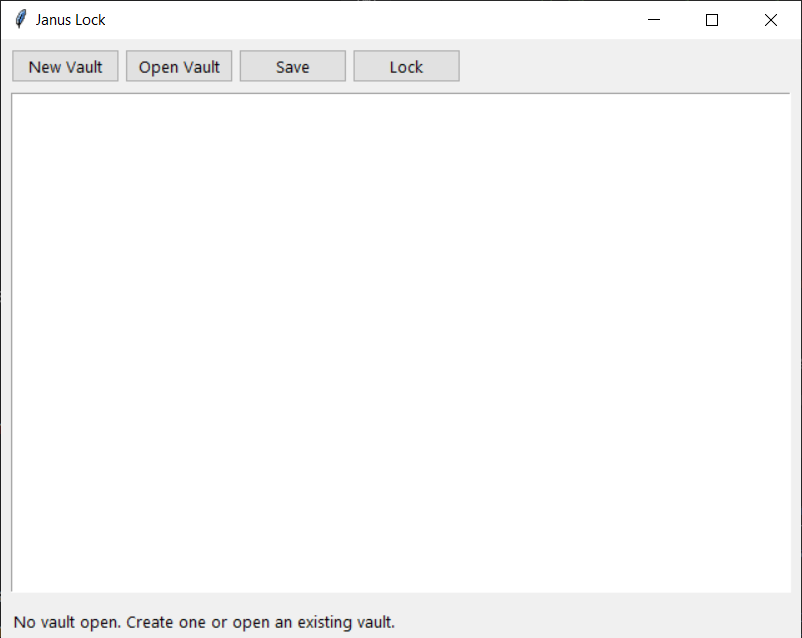

See [CHANGELOG.md](CHANGELOG.md) for version history.

*v0.1.1 — see [the pre-polish version](docs/screenshots/v0.1.0-window.png) for comparison.*

## How it works

Janus Lock uses standard, boring, well-understood cryptography. Nothing is
invented here — the job is to *use* good primitives correctly, not to design
new ones.

### The chain of trust

    master password
          │
          ▼
    ┌─────────────┐
    │   scrypt    │  ← slow + memory-hard, deliberately expensive to guess
    └─────────────┘
          │
          ▼
      256-bit key
          │
          ▼
    ┌─────────────┐
    │  AES-GCM    │  ← encrypts AND authenticates: tampering is detected
    └─────────────┘
          │
          ▼
      vault file

### The vault file format

Every `.janus` file is laid out like this:

    [ magic ][ version ][ salt ][ nonce + ciphertext ]
      4 B       1 B       16 B       variable

| Field | Purpose |
|---|---|
| `magic` (`JNUS`) | Identifies the file as a Janus Lock vault |
| `version` | Lets the format evolve without breaking old vaults |
| `salt` | Unique per vault; makes the key derivation resistant to rainbow tables |
| `nonce` | Unique per save; required for AES-GCM safety |
| `ciphertext` | Your data, encrypted and authenticated |

The salt and nonce are stored **in the clear** — that's correct and intentional.
Neither is secret; they only need to be unique.

### Why these choices

- **scrypt** instead of a fast hash: passwords are short and guessable. scrypt
  makes each guess slow and memory-hungry, so brute-forcing a stolen vault
  becomes expensive rather than instant.
- **AES-GCM** instead of AES-CBC: GCM detects tampering. Flip one bit in the
  ciphertext and decryption *fails loudly* instead of returning silent garbage.
- **Atomic saves**: writes go to a temp file first, then get renamed over the
  target. A crash mid-save leaves you with the *old* vault, never a corrupt one.
- **No passwords on the command line**: they'd leak into shell history and
  process listings. The CLI prompts interactively instead.

### What's *not* protected against

Being honest about the threat model is part of building security software.

- **A weak master password.** scrypt slows attackers down, but "password123"
  is still guessable. Use a real passphrase.
- **A compromised machine.** Keyloggers, memory dumps, malware — none of that
  is in scope. This protects *data at rest*, not data in use.
- **Forgotten passwords.** There is no recovery. If you lose the password,
  the vault is gone. Back up your vault file *and* remember the password.

## Project structure

    janus-lock/
    ├── januslock/
    │   ├── crypto.py      # key derivation + AES-GCM (pure bytes in/out)
    │   ├── storage.py     # vault file format + atomic saves
    │   ├── cli.py         # command-line interface
    │   └── gui.py         # Tkinter front-end
    ├── tests/
    │   ├── test_crypto.py
    │   └── test_storage.py
    └── README.md

The layers are strictly separated: `crypto` knows nothing about files,
`storage` knows nothing about UI, and both `cli` and `gui` are thin shells
over `storage`.

## Usage

### GUI

    python -m januslock.gui

### CLI

    # Create a new empty vault
    python -m januslock.cli init my.janus

    # Unlock and print the contents
    python -m januslock.cli show my.janus

    # Unlock and replace the contents
    python -m januslock.cli set my.janus

You'll be prompted for the master password interactively — it is never
passed as a command-line argument.

## Development

    # Set up
    python -m venv .venv
    .venv\Scripts\activate       # Windows
    pip install -r requirements.txt

    # Run tests
    pytest

## Status

Working, tested, small. Built as a learning project to understand
encryption-at-rest from the ground up.

## License

MIT